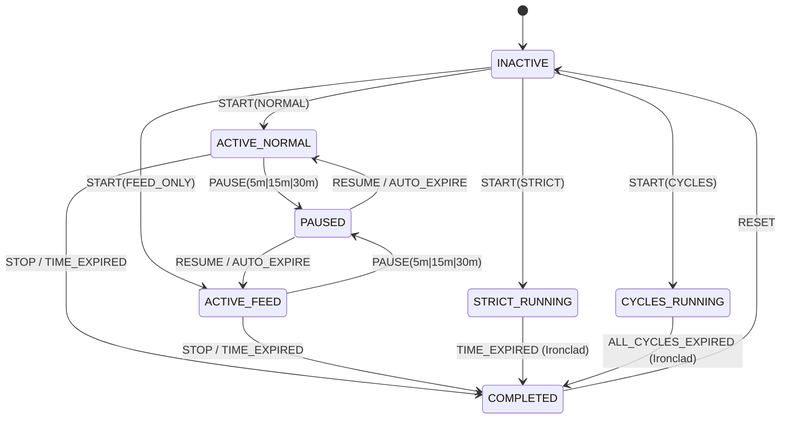

# FocusDNS Shared Session Engine Specification (v1.0.0)

This document is the authoritative cross-platform specification for the FocusDNS session lifecycle, hierarchical finite state machine, monotonic timeline anchoring, pure policy evaluation (`isBlocked`), and event-sourced append-only storage.

Implementations in **Kotlin (Android)**, **Swift (iOS)**, **Go (Cloud API)**, and **TypeScript (Extension & Admin)** MUST conform strictly to this specification and pass 100% of the test vectors in `vectors/state_machine_vectors.json`.

---

## 1. Architectural Philosophy

1. **Local-First Enforcement**: All session constraints and block decisions are computed locally on device without network roundtrips.
2. **Absolute Timestamps Over Countdowns**: Timelines are precomputed as absolute epoch millisecond intervals `[startEpochMs, endEpochMs)`. The engine NEVER computes enforcement from decrementing countdown variables.
3. **Alarms Are Wake Signals Only**: Alarms and OS timers merely awaken the process. System correctness NEVER depends on alarms firing on time. On every wake event (network packet, accessibility inspection, alarm, screen on, or app foregrounding), the engine runs a catch-up evaluation against the precomputed timeline.
4. **Monotonic Clock Anchoring**: The system clock (`System.currentTimeMillis()`) can be manipulated by users or network updates. All intervals are anchored against the device's monotonic clock (`SystemClock.elapsedRealtime()` on Android, `clock_gettime(CLOCK_MONOTONIC)` on Linux/Darwin, `mach_continuous_time()` on iOS) to prevent tampering.
5. **Pure Evaluation (`isBlocked`)**: Policy decisions are decoupled from state mutation through a deterministic, side-effect-free function:
   $$\text{isBlocked}(\text{target}, \text{nowMs}, \text{state}) \to \text{Decision}$$
6. **Append-Only Idempotent Event Log**: All state changes are emitted as immutable events with monotonic sequence IDs and idempotency keys. Replaying the event stream in order is guaranteed to regenerate the identical state snapshot.

---

## 2. Session Modes and Boundaries

FocusDNS supports exactly four session modes:

| Mode | Allowed Pause Durations | Can Stop Early? | Min Session Duration | Max Session Duration | Enforced Subfeatures |
|---|---|---|---|---|---|
| `NORMAL` | 5m, 15m, 30m | Yes (Anytime) | 1 min (60,000 ms) | 24 hr (86,400,000 ms) | Configured Apps, Categories & Feeds |
| `STRICT` | None (Forbidden) | **NO*** (Locked until timer ends) | 5 min (300,000 ms) | 8 hr (28,800,000 ms) | Configured Apps, Categories & Feeds |
| `CYCLES` | None (Forbidden) | **NO*** (Locked until timer ends) | Focus: 5m - 480m<br>Break: 5m - 30m | Total: up to 24 hr<br>Cycles: 1 to 12 | Focus: Full Block<br>Break: Apps Allowed |
| `FEED_ONLY` | 5m, 15m, 30m | Yes (Anytime) | 1 min (60,000 ms) | 24 hr (86,400,000 ms) | Feeds, Reels, Shorts, Explore Only |

*\*Note: In `STRICT` and `CYCLES` modes, normal stop/abort attempts are strictly rejected with `ERR_STRICT_LOCKOUT_ACTIVE`. Early termination is ONLY permitted through the **15-Second Emergency Panic Override** (`holdDurationMs >= 15_000`), emitting `SessionAborted` with reason `EmergencyPanicOverride_15sHoldConfirmed`.*

### Hard Validation Limits
- `STRICT` duration: **[5, 480] minutes** inclusive. Any request $< 5$ min or $> 480$ min MUST be rejected with `ERR_OUT_OF_BOUNDS`.
- `CYCLES` focus duration: **[5, 480] minutes** inclusive.
- `CYCLES` break duration: **[5, 30] minutes** inclusive. Requests $< 5$ min or $> 30$ min MUST be clamped or rejected with `ERR_OUT_OF_BOUNDS`.
- `CYCLES` cycle repetitions: **[1, 12]** cycles.
- `PAUSE` duration: strictly one of **`[5, 15, 30]` minutes**. Pausing in `STRICT` or `CYCLES` mode MUST be rejected with `ERR_PAUSE_NOT_ALLOWED`.
- Normal Abort in `STRICT` or `CYCLES`: MUST be rejected with `ERR_STRICT_LOCKOUT_ACTIVE`.
- Emergency Panic Override: MUST verify continuous physical hold duration $\ge 15,000$ ms. Any hold $< 15,000$ ms MUST be rejected with `ERR_PANIC_HOLD_TOO_SHORT`.


---

## 3. Finite State Machine (FSM)

### 3.1 Primary Session States



### 3.2 Cycles Sub-Phase Hierarchy

When `CYCLES_RUNNING` is active, the engine tracks deterministic sub-phases for each cycle $k \in [1, N]$:

1. `PREPARATION_GRACE` (Default: 10s): User prepares workspace; audio chime emitted.
2. `FOCUS_SESSION` (Duration: $T_{\text{focus}}$): Deep focus; strict blocking on apps, categories, and DNS sinkhole.
3. `BREAK_SESSION` (Duration: $T_{\text{break}} - 30\text{s}$): Distracting apps temporarily unblocked.
4. `BREAK_EXPIRING_GRACE` (Duration: 30s): Warning pulse; audio chime warning; break ending.
5. `APP_TERMINATION_SWEEP` (Instantaneous / 0s): Accessibility service fires `GLOBAL_ACTION_HOME` or closes foreground distracting packages; immediate re-engagement of blocks.
6. `CYCLE_ADVANCE`: Advances $k \leftarrow k + 1$. If $k > N$, transitions to `COMPLETED`.

---

## 4. Timeline Computation and Monotonic Clock Anchoring

### 4.1 Timeline Precomputation
Given start epoch $t_0$, monotonic baseline $m_0$, and session configuration, the engine precomputes an immutable array of phase intervals:

$$\text{Phase}(i) = \{ \text{phaseId}, \text{phaseType}, \text{cycleNumber}, \text{startMs}, \text{endMs} \}$$

For `CYCLES` with focus duration $F$, break duration $B$, prep grace $G_p=10\text{s}$, and break grace $G_b=30\text{s}$:
- Phase 0: Prep Grace: $[t_0, t_0 + G_p)$
- Phase 1: Focus 1: $[t_0 + G_p, t_0 + G_p + F)$
- Phase 2: Break 1: $[t_0 + G_p + F, t_0 + G_p + F + (B - G_b))$
- Phase 3: Break Grace 1: $[t_0 + G_p + F + (B - G_b), t_0 + G_p + F + B)$
- ... repeated for $N$ cycles.

Total end timestamp:
$$T_{\text{end}} = t_0 + G_p + N \cdot (F + B)$$

### 4.2 Monotonic Clock Anchoring & Sleep Tracking (Anti-Tamper)
To prevent clock alteration (e.g. setting system time forward 2 hours to escape Strict Mode):
1. **Sleep-Proof Continuous Monotonic Clocks**:
   - On **Android**: Use `SystemClock.elapsedRealtime()`, which continues ticking while CPU is in deep sleep.
   - On **iOS**: Use Darwin `mach_continuous_time()` with `mach_timebase_info`, which continues ticking while device is locked and asleep (replaces non-continuous `ProcessInfo.processInfo.systemUptime`).
2. On session start, record:
   - `wallStartEpochMs` $= \text{System.currentTimeMillis()}$
   - `monoStartMs` $= \text{ContinuousUptimeMs()}$
3. On any evaluation at current instant $(\text{wallNowMs}, \text{monoNowMs})$:
   $$\text{elapsedMono} = \text{monoNowMs} - \text{monoStartMs}$$
   $$\text{effectiveNowMs} = \text{wallStartEpochMs} + \text{elapsedMono}$$
4. If $\text{wallNowMs} < \text{wallStartEpochMs}$ (system clock set backward) OR $\text{wallNowMs} - \text{effectiveNowMs} > 15,000\text{ms}$ (clock jumped forward artificially):
   - The engine flags `TAMPER_CLOCK_DRIFT_DETECTED`.
   - The engine uses $\text{effectiveNowMs}$ derived from the continuous monotonic clock as the ground truth.
   - Strict / Cycles sessions CANNOT complete until $\text{elapsedMono} \ge \text{targetDurationMs}$.

### 4.3 Reboot Recovery & Atomic Time Reconciliation (Option 5)
When a device reboots, monotonic counters reset to 0. The engine reconciles state on boot:
1. Detect reboot via OS boot notification (`ACTION_BOOT_COMPLETED`) or `currentMonoNowMs < lastPersistedMonoTickMs`.
2. Query verified atomic/network time (`networkTimeEpochMs`) from secure SNTP / HTTP Date headers.
3. If $\text{networkTimeEpochMs} \ge \text{persistedTotalTargetEndEpochMs}$:
   - Session completed while device was powered off $\to$ transition to `COMPLETED`.
4. If $\text{networkTimeEpochMs} < \text{persistedTotalTargetEndEpochMs}$:
   - Calculate $\text{remainingMs} = \text{persistedTotalTargetEndEpochMs} - \text{networkTimeEpochMs}$.
   - Re-anchor `monoStartMs` $\leftarrow \text{currentMonoNowMs}$.
   - Re-anchor `wallStartEpochMs` $\leftarrow \text{networkTimeEpochMs}$.
   - Re-anchor `totalTargetEndEpochMs` $\leftarrow \text{networkTimeEpochMs} + \text{remainingMs}$.
   - Session remains locked for the verified remaining duration.


---

## 5. Catch-Up Evaluation Algorithm

When awakened, the engine evaluates:
```
function evaluateCatchUp(nowMonoMs, state):
    effectiveNow = state.wallStartEpochMs + (nowMonoMs - state.monoStartMs)

    if effectiveNow >= state.totalTargetEndEpochMs:
        state.phase = COMPLETED
        state.activePhaseIndex = state.phases.length - 1
        return [ Event(SessionCompleted) ]

    currentPhase = state.phases.find(p => effectiveNow >= p.startMs && effectiveNow < p.endMs)
    if currentPhase.index != state.activePhaseIndex:
        oldPhase = state.phases[state.activePhaseIndex]
        state.activePhaseIndex = currentPhase.index

        events = [ Event(PhaseAdvanced, from=oldPhase, to=currentPhase) ]
        if oldPhase.phaseType == BREAK_EXPIRING_GRACE and currentPhase.phaseType == FOCUS_SESSION:
            events.append( Event(AppTerminationSweepTriggered) )
        return events

    return []
```

---

## 6. Deterministic Policy Evaluation: `isBlocked()`

The function signature:
```typescript
interface Decision {
  isBlocked: boolean;
  reason: string;
  enforcedBy: 'DNS' | 'SHIELD' | 'FEED_INSPECTOR' | 'NONE';
  allowFallback: boolean;
}

function isBlocked(target: Target, nowMs: number, state: SessionState): Decision
```

### Decision Matrix

| Session State | Active Phase | Target Subfeature | Target Package/Domain Status | Category Status | `isBlocked` Result | `enforcedBy` |
|---|---|---|---|---|---|---|
| `INACTIVE` | - | Any | Blocked in Profile | Blocked in Profile | `false` | `NONE` |
| `COMPLETED` | - | Any | Blocked in Profile | Blocked in Profile | `false` | `NONE` |
| `PAUSED` | - | Any | Any | Any | `false` | `NONE` |
| `ACTIVE_FEED` | - | `reelsOrShorts`, `feed`, `explore` | In Supported App (IG, YT, TikTok, Reddit) | - | **`true`** | `FEED_INSPECTOR` |
| `ACTIVE_FEED` | - | `messages`, `watch`, `search` | In Supported App | - | **`false`** | `NONE` |
| `ACTIVE_NORMAL` | - | Any | Listed in App Blocklist | - | **`true`** | `SHIELD` / `DNS` |
| `ACTIVE_NORMAL` | - | Any | Domain matches Denylist | - | **`true`** | `DNS` |
| `ACTIVE_NORMAL` | - | Any | In Blocked Category (Adult, Gambling, etc.) | Blocked | **`true`** | `DNS` |
| `STRICT_RUNNING` | - | Any | Any matched rule in session | Any | **`true`** | `SHIELD` / `DNS` |
| `CYCLES_RUNNING` | `FOCUS_SESSION` | Any | Any matched rule in session | Any | **`true`** | `SHIELD` / `DNS` |
| `CYCLES_RUNNING` | `BREAK_SESSION` | Any | Social App (IG, YT, Reddit, etc.) | - | **`false`** | `NONE` |
| `CYCLES_RUNNING` | `BREAK_SESSION` | Any | Malicious / Adult / Gambling Category | Blocked | **`true`** | `DNS` |
| `CYCLES_RUNNING` | `BREAK_EXPIRING_GRACE` | Any | Social App | - | **`false`** (Warning) | `NONE` |

### Degraded VPN Conflict Handling
When a third-party VPN takes over the OS network interface (`tun0` lost):
- `state.isVpnDegraded` is set to `true`.
- `enforcedBy == 'DNS'` rules degrade to `allowFallback: true` and are logged as degraded.
- `enforcedBy == 'SHIELD'` and `enforcedBy == 'FEED_INSPECTOR'` (Accessibility & ManagedSettings shields) **REMAIN 100% ACTIVE**.
- The app emits `TamperAlertLogged(type: "VPN_CONFLICT_DEGRADED")`.

---

## 7. Append-Only Event Sourcing Schema

All state transitions emit immutable events structured as:
```json
{
  "eventId": "evt_01J9...",
  "sessionId": "ses_01J9...",
  "sequenceNumber": 1,
  "eventType": "SessionStarted",
  "timestampEpochMs": 1732104000000,
  "monoTimestampMs": 18239012,
  "idempotencyKey": "idem_start_01J9...",
  "payload": { ... }
}
```

### Event Hierarchy
1. `SessionCreated`: Session initialized with validated config and precomputed timeline.
2. `SessionStarted`: Session transitions from `INACTIVE` to running mode.
3. `SessionPaused`: Normal or Feed session paused for 5, 15, or 30 min.
4. `SessionResumed`: Paused session resumed manually or via timer expiration.
5. `PhaseAdvanced`: Active phase advanced (e.g. Focus $\to$ Break).
6. `AppTerminationSweep`: Break expired, foreground distracting packages killed.
7. `SessionCompleted`: Natural expiration of strict duration or cycles.
8. `SessionAborted`: Permitted manual stop (Normal / Feed mode only).
9. `TamperDetected`: Clock manipulation, VPN loss, or accessibility crash recorded.

---

## 8. Double Verification & Network Anti-Bypass Armor (Sprint 2)

### 8.1 Two-Tier Double Verification Engine
Every accessed website and launched application undergoes deterministic two-tier verification:

1. **Tier 1 (Explicit Target Verification)**:
   - Evaluates whether the requested domain matches an exact entry or wildcard suffix in the active blocklist.
   - Evaluates whether the foreground application package name is in the configured blocked application set.
   - If matched: Emits block decision with `reason = "Double Verification Tier 1: Match in blocklist"`.

2. **Tier 2 (Category & Lexical Verification)**:
   - For domains: Evaluates domain sub-tokens, hyphenated labels, and TLD priors (`.xxx`, `.casino`, `.bet`, etc.) against standardized category feature vocabularies (`ADULT_CONTENT`, `CRYPTO_GAMBLING`, `GAMING`, `SOCIAL_MEDIA`, `PIRACY`).
   - For applications: Evaluates package name tokens (`.casino.`, `.betting.`, `.games.`) and foreground window titles against category vocabularies.
   - If matched: Emits block decision with `reason = "Double Verification Tier 2: Address/name matches blocked category (<category>)"`.

3. **Pass-Through**:
   - If neither Tier 1 nor Tier 2 matches a blocked target or category, the domain or application is clean and permitted immediately (`isBlocked: false`).

### 8.2 Android Network Anti-Bypass Armor
- **TCP Port 53 Fallback**: Intercepts TCP DNS queries on `10.254.1.2`, parses length-prefixed DNS messages, and synthesizes TCP NXDOMAIN or RST packets.
- **IPv6 Interception**: Handles IPv6 DNS queries on `fd00::1:53` with RFC 2460 pseudo-header checksum recalculation.
- **DNS-over-TLS (Port 853) Blocking**: Rejects port 853 packets (via TCP RST / immediate drop) to disable Android OS "Private DNS" bypass probes and enforce local tunnel resolution.
- **VPN Loop Prevention**: All outbound upstream DoH connections hook to `VpnService.protect(socket)` to eliminate routing feedback loops.

### 8.3 Zero-Log Local DNS Upstreams
- Unblocked queries resolve directly on-device via public zero-log encrypted DoH:
  - Primary: `https://cloudflare-dns.com/dns-query` (RFC 8484)
  - Fallback: `https://dns.quad9.net/dns-query` (RFC 8484)
- Eliminates centralized DNS honeypots and server-side browsing history exposure.
